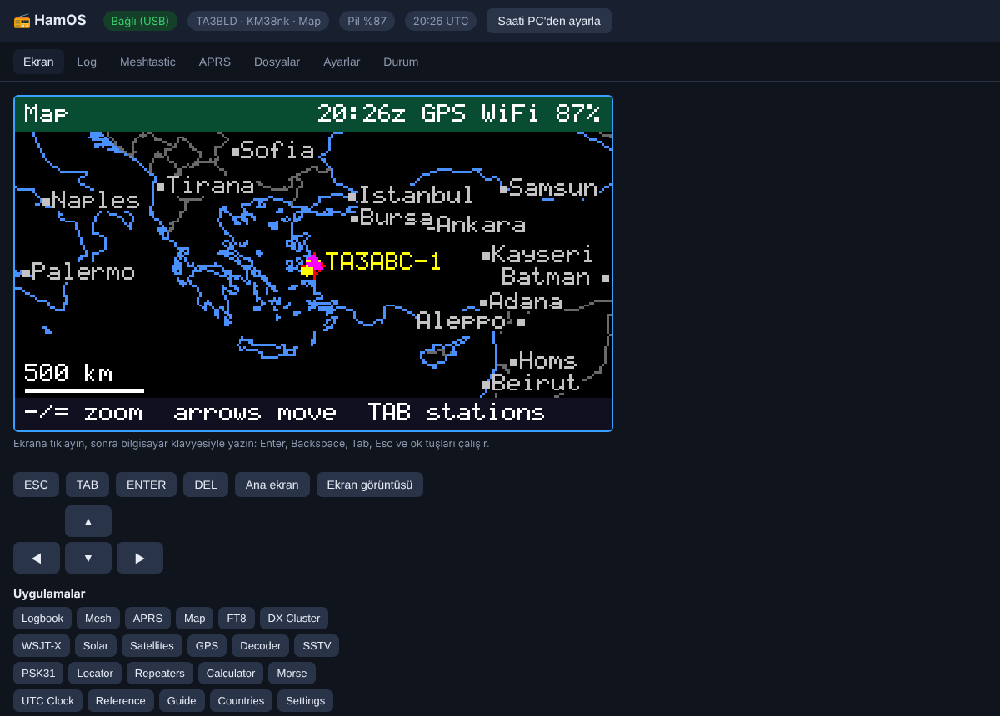
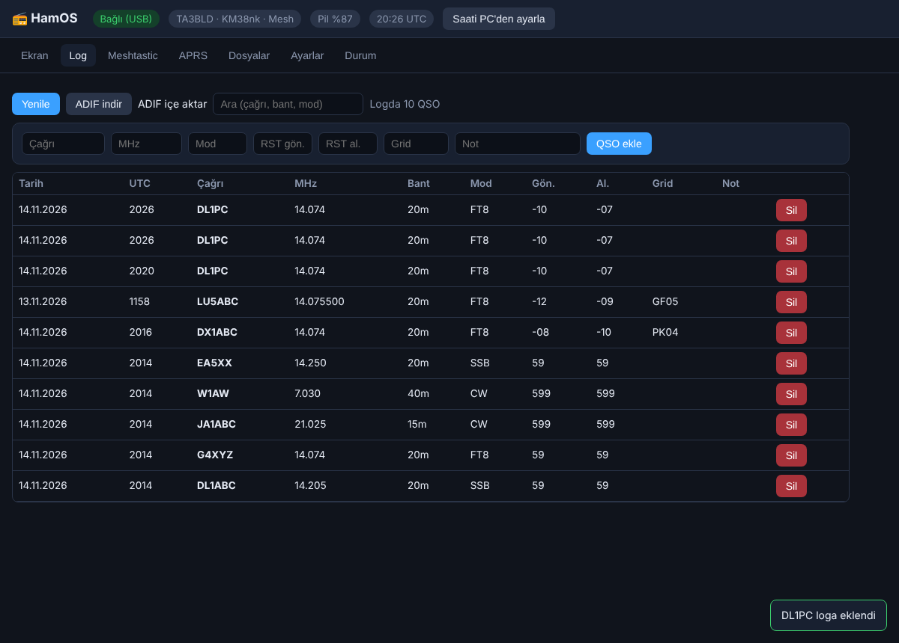
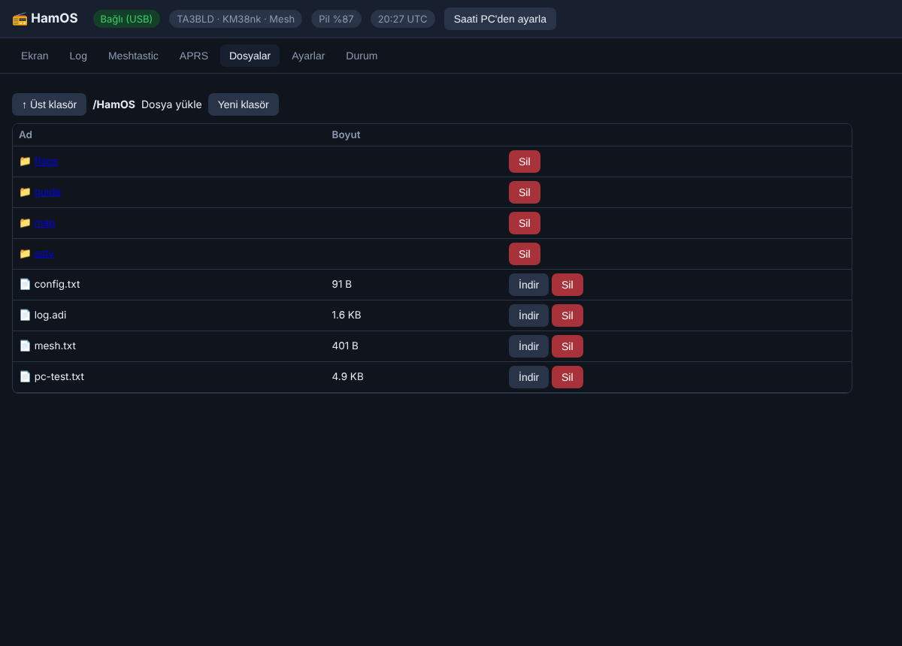
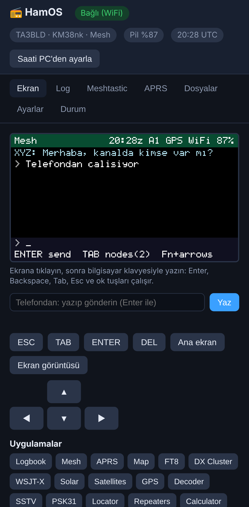

# Cardputer HamOS

An amateur radio toolkit for the M5Stack Cardputer ADV (with or without the LoRa + GNSS cap): one firmware, many small apps behind a launcher.

## Status

**Not yet built with PlatformIO or flashed on hardware.** Everything below runs on a PC in a simulator with fake GPS, LoRa, audio and network data; that is where the screenshots come from (the font on the device differs slightly). Expect a round of fixes on the first real build. See [What has been verified](#what-has-been-verified).


| App | What it does | Needs |
|---|---|---|
| Logbook | QSOs in a standard ADIF file. Country, flag, distance and beam heading while you type the call; new countries and dupes flagged; band and UTC filled in; frequency and mode from the radio with rig control. POTA reference and contest serial numbers optional. | SD card |
| Mesh | Meshtastic-compatible chat, node list (signal, hops, distance, bearing), radio status | LoRa cap |
| APRS | Stations and two-way messages over APRS-IS and LoRa-APRS (433.775 MHz); 1200 baud AFSK modem on the microphone and speaker; Mic-E decoding; receive-only iGate | WiFi / LoRa cap / a radio |
| Map | Offline map: coastlines, borders, place names, Maidenhead grid, APRS stations, mesh nodes, your position | SD card |
| FT8 / FT4 | FT8 (and FT4 with M) on the device: decodes from the microphone, answers a CQ or calls CQ through the speaker, runs the contact and logs it | time (WiFi or GPS), a radio |
| DX Cluster | Live telnet spots with band filter and flags; countries you never logged are highlighted and beep | WiFi |
| WSJT-X | Second screen for WSJT-X / JTDX on a PC; contacts logged there go into the HamOS log | WiFi + PC |
| Solar | Solar flux, A/K index and HF band conditions from hamqsl.com; sunrise/sunset for your grid | WiFi (sun times offline) |
| Satellites | Live azimuth/elevation/range and Doppler, next passes over your location | WiFi once, for orbit data |
| GPS | Position, grid locator, altitude, speed; sets the clock without internet | LoRa cap |
| Decoder | Morse code (automatic speed) and RTTY (45 baud, 170 Hz) from the microphone; RTTY CQ through the speaker | a receiver nearby |
| SSTV | Receive pictures (10 modes) live on screen and to the SD card; send pictures from the SD card with your callsign on them | a radio |
| PSK31 | Waterfall, tuning with AFC, keyboard chat | a radio |
| Locator | Distance and beam heading between two locators | |
| Repeaters | Your repeater list from the SD card, nearest first | SD card |
| Calculator | Antenna length, SWR, dBm/Watt, feedline loss, LC resonance, Ohm's law | |
| Morse | Type-to-send practice and a Koch-method trainer | |
| UTC Clock | UTC and local time | |
| Reference | Q codes, phonetic alphabet, RST, band edges | |
| Guide | Reading pages in Turkish from the SD card: band plan, FT8, APRS, Meshtastic, propagation, satellites, digital modes, antennas, emergency, Morse | SD card |
| Countries | Flag, prefixes, short and long path with compass, sunrise and sunset, logged or not | SD card for flags |
| POTA/SOTA | Live spots (tune the radio with T), parks and summits near you, today's activation count, spotting yourself on pota.app | WiFi |
| PSK Reporter | Who heard you in the last hour; reports your FT8 decodes | WiFi |
| Callbook | Name, town and locator from HamQTH or QRZ.com; the logbook fills them in | WiFi + account |
| Log upload | eQSL, Club Log, QRZ.com logbook (only new contacts); Cabrillo file | WiFi + account |
| Radio | Frequency and mode, tuning, band presets, PTT (CI-V, FT-817, Kenwood, Yaesu cable on the Grove port; IC-705 over Bluetooth; rigctld) | a radio |
| CW keyer | Six memories, typed CW, iambic paddle on the Grove port | |
| Voice keyer | Four recorded messages sent with PTT, CQ loop | |
| Range test | LoRa range test with GPS (compatible with Meshtastic's), dots on the map | LoRa cap |
| WX / Digi | BME280 weather station with APRS weather reports; LoRa-APRS digipeater | sensor / LoRa cap |
| Contest | Callsign + number, ENTER logs; serial numbers, dupes, rate, CW exchange | |
| Awards | DXCC, continents, the 81 Turkish provinces, grid squares | |
| Alerts | Watch list (calls, prefixes, parks, new countries) from cluster, FT8 and POTA; band openings from PSK Reporter | WiFi |
| WSPR | Beacon in two-minute slots with PTT; who heard you (wspr.live) | a radio |
| CW practice | A simulated station calls CQ; copy its call and exchange | |
| Net control | Check-in list with traffic marks, saved per net | |
| Message form | Numbered formal message with word count, sent over mesh / APRS | |
| Tracker | SmartBeaconing position beacons; mesh mailbox (store and forward) | GPS + LoRa |
| Self test, Audio levels, Profiles, Setup wizard | Check every part; set mic and transmit levels; switch sets of settings; first start | |
| Settings | Everything, editable on the device | |
| Update | Checks GitHub for a new release; installs only after you confirm; returns to the old version if the new one fails to start | WiFi |
| Emergency | SOS over mesh / LoRa-APRS / APRS-IS with repeats, status messages, safety timer, siren, light, battery saver, alerts for others' calls. Hold G0 for 2 s from anywhere | |

The interface is Turkish by default (Settings: Language tr/en). In the launcher TAB switches groups, typing searches by name and Fn+ENTER marks favourites. The status bar shows UTC time, unread mesh (`M3`) and APRS (`A1`) messages, GPS fix, WiFi and battery. Turkish letters (ç ğ ı İ ö ş ü) are shown everywhere; the built-in font lacks them, so HamOS draws them itself. The screen dims after a minute without key presses.

## SD card

Copy the contents of the `sdcard` folder to the root of a FAT32 microSD card (about 10 MB). It holds the guide pages, flags, map data and two sample SSTV pictures. HamOS also writes its settings, logbook and received pictures there. It boots without a card, but then nothing is saved and the map, flags and guide are missing.

| File | Content |
|---|---|
| `/HamOS/config.txt` | Settings as `key=value`. The WiFi password and mesh key are stored in plain text. |
| `/HamOS/log.adi` | The logbook (ADIF). `log.bak` is the copy from before the last delete. |
| `/HamOS/mesh.txt` | Every mesh message sent or received |
| `/HamOS/tle.txt` | Satellite orbit data |
| `/HamOS/repeaters.csv` | Your repeater list: `name,MHz,shift,tone,lat,lon,note` (see `docs/repeaters-example.csv`) |
| `/HamOS/guide/*.txt` | Guide pages; add your own (`# Title`, `## Heading`, `- bullet`, `> note`) |
| `/HamOS/flags`, `/HamOS/map` | Flags and map data (made by `tools/flags` and `tools/map`) |
| `/HamOS/sstv` | Pictures to send (24-bit BMP, any size) and received pictures |

## Keys

| Key | Action |
|---|---|
| `;` `.` `,` `/` (with or without Fn) | Up / down / left / right |
| `ENTER` | Open / edit / save / send |
| `TAB` | Next field or page |
| `` ` `` or Fn+`` ` `` (ESC) | Cancel / back to the launcher |
| Fn + arrows | On screens where `;` `.` `,` `/` are text (chat, PSK31): scroll or tune |
| `-` / `=` | Zoom on the map |

## Build

```bash
pio run -t upload
```

`platformio.ini` pins RadioLib to 7.1.2 and needs M5Cardputer 1.1.0 or newer for the ADV. HamOS builds with both layouts of that library's keyboard state (1.1.1 moved Backspace, Esc and the arrows into new fields).

## Audio

The sound modes (FT8, SSTV, PSK31, RTTY, CW, APRS modem) listen through the Cardputer's microphone: hold it next to the receiver's speaker. They send through the speaker and the headphone jack; the jack into the radio's microphone or data input with VOX is the cleanest way. Keep the level low enough that the radio's ALC does not act. Acoustic coupling works but is the weak point; it has not been tried on real radios yet.

## Apps in detail

### FT8

Needs the time to within about half a second (WiFi/NTP, or GPS). Every 15 s period is decoded; CQs from countries not in the log are orange, messages to you green. ENTER on a CQ answers it in the other half of the minute and runs the standard sequence (grid, report, R-report, RR73, 73) like WSJT-X, logging the contact with both reports and the grid. `C` calls CQ, `T` pauses sending, `H` halts. Settings: `FT8 dial MHz` (for the log, or taken from rig control), `FT8 TX audio Hz`. Standard messages and 13-character free text; compound callsigns cannot be sent. The decoder needs about 180 KB of RAM and uses a coarser frequency grid (about 3 dB less sensitive) when less is free.

### APRS

- **APRS-IS** (`APRS-IS` = 1): logs in as `CALL-7`, shows stations within `APRS range` km, receives and acknowledges messages for you, sends messages (`CALLSIGN text` then ENTER; green once acknowledged). Requires an amateur licence, like any transmit login.
- **LoRa-APRS** (`LoRa mode` = `aprs`): the cap's radio runs on 433.775 MHz (SF12, 125 kHz, CR 4/5) instead of Meshtastic. Received packets join the station list marked LoRa; the beacon and messages go out over LoRa when it is on. `LoRa beacon min` sends the position periodically (at least every 5 minutes), `LoRa iGate` = 1 forwards what is heard to APRS-IS. The cap is built for 868 MHz; on 433 MHz it works without a matching filter, with less efficiency.
- **Radio modem** (third page): decodes 1200 baud AX.25 from the microphone (a receiver on 144.800 MHz next to the Cardputer); `B` plays your position packet through the speaker.
- Positions: plain, compressed and Mic-E.

### Map

Coastlines and borders at three levels of detail, places with 1000 or more people, the Maidenhead grid (`G`), place names (`C`). `-`/`=` zoom from 10 to 20000 km across, arrows move, `H` back to your position, TAB steps through the stations with distance and bearing, ENTER centres on one.

### SSTV

Modes: Martin M1/M2, Scottie S1/S2/DX, Robot 36/72, PD 90/120/180. Receive: the mode is found from the VIS header (or chosen with `M` and started at the next sync), the picture appears line by line with a tuning meter, slant from clock differences is corrected, and it is saved as a BMP in `/HamOS/sstv`. Send (TAB): choose a picture and a mode (`M`); your callsign is written in the corner (`O` to switch off).

### PSK31

The waterfall shows 300-2700 Hz. Fn+`,`/`/` tune by 10 Hz, Fn+`;`/`.` by 1 Hz, TAB jumps to the signal next to the cursor and the AFC follows it. Type a line and ENTER to send; ENTER on an empty line sends a CQ.

### Mesh (Meshtastic)

HamOS speaks the Meshtastic radio protocol, so it talks to ordinary Meshtastic nodes and phones. Defaults match a factory-fresh node: `EU_868` (869.525 MHz), `LongFast`, the public key. Channel messages both ways, node names, positions, signal, hops, acknowledgements to you. Not implemented: relaying other nodes' packets (HamOS is `CLIENT_MUTE`), direct messages with the newer public-key encryption, telemetry. Airtime stays within the EU duty cycle. Position sharing is off by default and coarsened to about 3 km when on. Licence-free ISM band, not amateur radio.

### Other

- **Decoder**: CW with automatic speed and a noise gate; RTTY 45.45 baud, 170 Hz, `R` for reverse, ENTER for a CQ.
- **Satellites**: `U` downloads orbit data from celestrak.org once; passes with local time, peak elevation, duration, direction; live Doppler on 2 m and 70 cm. Low orbits only.
- **WSJT-X**: set `WSJT-X link` = 1 and in WSJT-X the UDP server to the address shown, port 2237.
- **Logbook**: rig control through Hamlib's `rigctld` (`Rig host`); `POTA park ref`; `Contest mode`; `ID reminder min`.
- **Web interface** (`Web UI` = 1): the control panel below over WiFi, plus log download and firmware update (only with a `Web UI password`).

## Control from a PC or phone

Plug the Cardputer into a computer with the USB cable and control all of it from there: the live screen with the PC keyboard, opening apps, the logbook (add, delete, ADIF export and import), Meshtastic and APRS messages, files on the SD card (upload, download, delete, folders), every setting, the clock, restart.

| | |
|---|---|
|  |  |
|  |  |

Three ways to open the same panel:

1. **PC program**: `pip install pyserial`, then `python tools/pc/hamos_pc.py`. It opens the panel in the browser, finds the Cardputer by itself and reconnects whenever it is plugged in again. Windows, macOS and Linux.
2. **Without installing anything**: open `tools/pc/hamos.html` in Chrome or Edge and press *Cihaza bağlan (USB)* once; after that it connects as soon as the Cardputer is plugged in.
3. **Over WiFi, without a cable**: set `Web UI` = 1 and open `http://<device address>` (shown in Settings) on a phone or PC in the same network. A text box lets you type on a phone. Set a `Web UI password` if others share the network (user `hamos`).

The link is newline-separated JSON over the USB serial port (`src/core/Usb.h` lists the commands); over WiFi the same requests go to `POST /api`. The Cardputer's display cannot be read back, so the screen is mirrored by sending each drawing step, not pixels. `tools/pc/embed.py` puts `hamos.html` into the firmware (`src/core/WebPage.h`); run it after changing the page. `tools/sim/devsim.cpp` is a "device" on the PC for trying the panel without hardware.

## Meshtastic app over Bluetooth

With "Meshtastic app BT" = 1 the official Meshtastic app (phone or PC) connects to HamOS like to any Meshtastic node ("HamOS_xxxx"): nodes, positions, channel, messages both ways. `tools/sim/mesh_app_check.py` checks this with the Meshtastic Python client against the simulator.

## Installing and updating

- From the browser: `tools/flasher/index.html` (ESP Web Tools) installs `hamos-full.bin` over USB in Chrome or Edge.
- GitHub Actions (`.github/workflows/build.yml`) builds the firmware, runs the tests, and for a tag `vX.Y.Z` publishes a release; `pages.yml` puts the installer on GitHub Pages. The version is in `src/core/Version.h`.
- On the device: Update app. For a private repository set an "Update token" (a GitHub token that may read the repository).

## Logging programs on the PC

Set "Log to PC" to `host:port` (e.g. `192.168.1.255:12060` for the whole network) and every contact HamOS logs is sent as an N1MM Logger+ "contactinfo" message, which Log4OM, N1MM and others accept; "Log to PC format" = adif sends a plain ADIF record instead. The PC panel's Status tab backs up and restores the settings and installs a firmware file. `tools/m5burner/` packages a release for M5Burner.

## Hardware notes

LoRa + GNSS cap wiring, from the Meshtastic firmware's Cardputer ADV board definition and the `espp` Cardputer component:

| Signal | GPIO |
|---|---|
| SX1262 NSS / RST / DIO1 / BUSY | 5 / 3 / 4 / 6 |
| SPI SCK / MISO / MOSI (shared with microSD) | 40 / 39 / 14 |
| GNSS to ESP32 / ESP32 to GNSS, 115200 baud | 15 / 13 |
| I/O expander (Cap LoRa-1262 only), I2C 0x43 | SDA 8, SCL 9; P0 antenna switch, P1 GNSS LNA |

The radio starts with a 1.8 V TCXO and falls back to a crystal if that fails; `lora_tcxo=` in `config.txt` overrides it.

## Known limits

- The logbook list and dupe check cover the newest 200 contacts; the new-country check covers the whole log.
- The country table has about 150 common entities, not the full DXCC list.
- Loading solar or orbit data and connecting to the cluster, APRS-IS or rigctld block the keyboard for a few seconds.
- While a sound app is listening the speaker is off (microphone and speaker share one audio interface), so message beeps are silent there.
- Leaving the FT8 app ends a contact in progress.
- No repeater data is included; the example file contains made-up entries.

## What has been verified

On a PC, without hardware:

- **FT8** against the WSJT-X port in the Python package ft8lib (`tools/ft8/crosscheck.py`): message packing identical for 1519 of 1519 messages; ft8lib decodes the generated audio; HamOS decodes ft8lib's audio, all signals down to -17 dB SNR and half at -19 dB (WSJT-X: about -21), no false decodes. One difference found was in ft8lib, not HamOS (callsigns like A61AA, which WSJT-X's Fortran accepts).
- **SSTV** against the Python packages sstv (Rust) and pysstv (`tools/sstv/crosscheck.py`): transmissions as long as sstv's to the sample; sstv decodes them as well as its own; HamOS decodes sstv's signals in all ten modes with noise and a 0.1 % clock error.
- **FT4** and **WSPR** against ft8lib (`tools/ft8/crosscheck_ft4.py`, `crosscheck_wspr.py`): tones identical, ft8lib decodes the audio HamOS sends; HamOS decodes FT4 down to about -12 dB (WSJT-X: about -17). WSPR is transmit only.
- **PSK31**: Varicode identical to fldigi's; decodes an independent generator; 99 % of characters at 0 dB SNR.
- **Meshtastic** packets match the official Python library byte for byte; **satellite** positions match the Python sgp4 package within a metre; **Mic-E** matches aprslib; **map** reader tested on the real files.
- **Unit tests** (`test/host/`) for everything in `src/lib`.
- **Simulator** (`tools/sim/`): the real app code runs against stand-in hardware, driven by a script with end-to-end checks (a complete FT8 contact, an SSTV picture received and one sent, PSK31 tuned, read and answered, mesh, APRS-IS and LoRa-APRS, logging, keyboard), and renders the screenshots.
- **PC panel**: a browser test (Playwright) drives the page against the simulated device, through the PC program and over the simulated WiFi server: screen mirror, keyboard, apps, log, mesh, APRS, file upload and download, settings, status.
- **Library interfaces** checked against the M5Cardputer, M5Unified, M5GFX, RadioLib 7.1.2 and Arduino-ESP32 headers; sources compiled with Arduino's macros defined to catch name collisions.

Not verified: an actual PlatformIO build, anything on air, real microphone and speaker levels, the cap's TCXO voltage, the default DX cluster address.

## Data and licences

Flags: public domain (npm `svg-country-flags`, from Wikipedia). Map outlines: Natural Earth, public domain. Place names: GeoNames, CC BY 4.0. 5x7 font for SSTV callsigns: luma.core, MIT. The reference implementations above are used only for testing.

## Adding an app

1. Create `src/apps/MyApp.h` with a class deriving from `App` (`src/core/App.h`).
2. Add an instance to the app registry at the top of `src/main.cpp`.

Logic that does not need hardware goes in `src/lib/` and gets a test in `test/host/`:

```bash
for t in test_libs test_maidenhead test_radio test_modem test_sat test_ft8qso test_psk31 test_json test_web test_cat test_wx; do
  g++ -std=c++17 -O1 -I src test/host/$t.cpp -lcrypto -o test/host/t.out && test/host/t.out
done
g++ -std=c++17 -I src test/host/test_map.cpp -o test/host/t.out && test/host/t.out sdcard/HamOS/map
```

`tools/sim/run.sh` builds and runs the simulator and rewrites `docs/screens/` (needs `g++`, OpenSSL headers, Python with Pillow).

## Not done yet

- USB keyboard macros for PC logging programs
- SOTA self-spotting (needs an account login HamOS cannot do)
